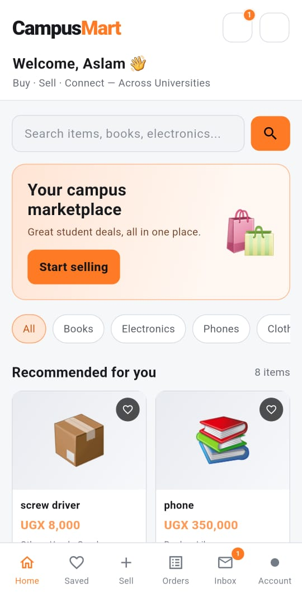
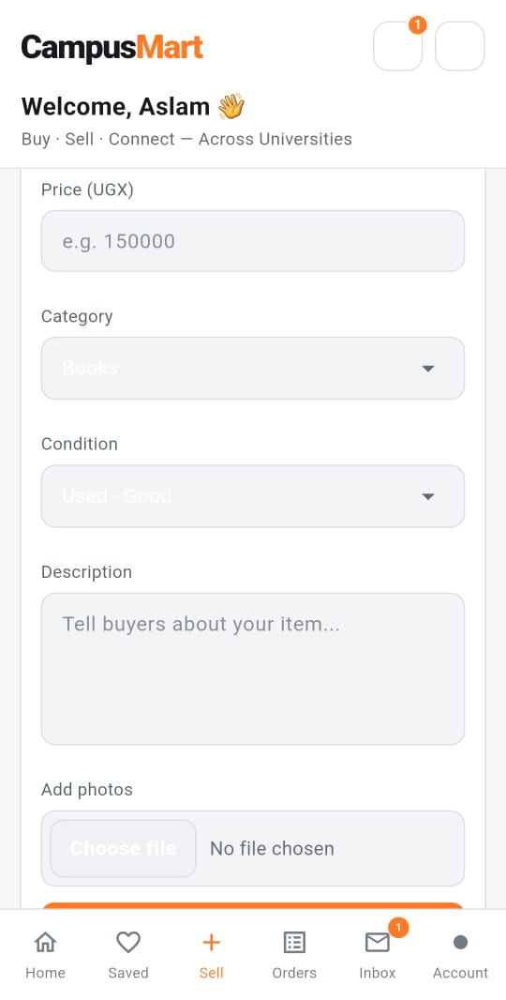
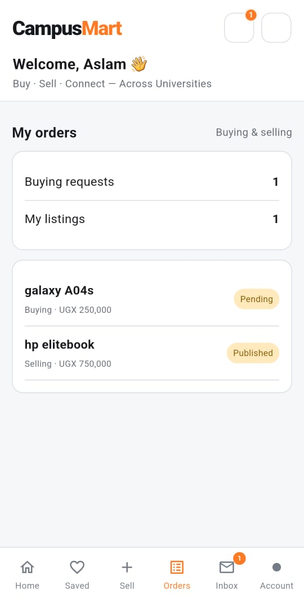
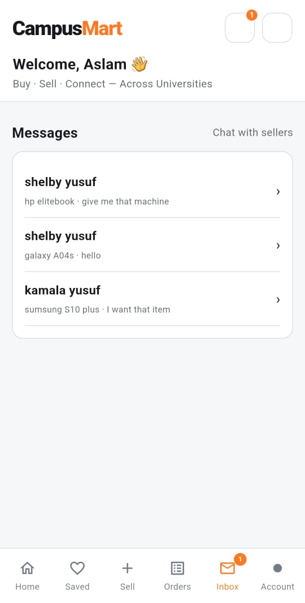
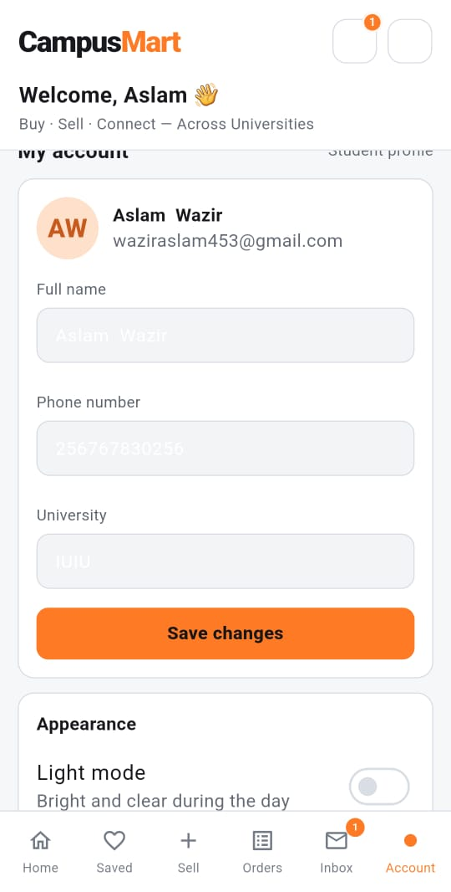

# CampusMart – Student Marketplace

**Islamic Call University College · Mobile Application & Design · Year 3, Semester 1 (Weekend)**
Capstone project · Demo: 23 November 2026

CampusMart is a mobile app where students buy and sell items within and across university communities (*Buy · Sell · Connect*): textbooks, phones, laptops, hostel items, clothes, stationery and services such as printing and tutoring. It replaces scattered WhatsApp posts and notice boards with one searchable place that only registered students use.

---

## Group members

| Name | Reg No | Course | Role |
| --- | --- | --- | --- |
| Kamara Yusuf | 241-22302-7631 | BIT Weekend | Backend lead (API, database, run instructions) |
| Muwonge Abbasi | 241-21301-7261 | BCS Weekend | Flutter lead (screens, navigation, forms) |
| Waziri Aslam | 241-22302-7521 | BIT Weekend | Analyst and integration lead (analysis, ERD, API docs, testing, README) |

All three members write code and commit to this repository every week.

---

## The problem and our solution

Students trade items through class WhatsApp groups and notice boards, where posts are hard to find later, cannot be searched by price, and give no way to know whether the seller belongs to the student community. General marketplaces such as Jiji and ZiBuy serve everyone, so students struggle to find nearby items that suit them.

With CampusMart a student can:

- Register and log in with a campus account
- Post an item with a photo, price, condition and campus pickup point
- Browse by category, search by keyword, filter by price, condition and campus, and sort
- Save items to favourites
- Message a seller about an item
- Send a purchase request, which the seller accepts or rejects, then agree on a campus meeting point
- Track orders from request to completion

Payment and delivery are out of scope: cash or mobile money is handed over at the meet-up.

---

## Features

| Area | What is implemented |
| --- | --- |
| Authentication | Register, login, JWT token, bcrypt password hashing, logout clears the token, 401 on protected endpoints |
| Profile | View and edit own profile (name, phone, university), delete own account, light / dark mode |
| Listings | Create, view, edit, delete, mark available / reserved / sold, My Listings, photo upload |
| Discovery | Paged list (20 per page), keyword search, filters, sorting |
| Favourites | Add, remove, view saved items |
| Orders | Purchase request, accept / reject / complete (seller), cancel while pending (buyer) |
| Messages | Inbox tab with unread badge, one entry per conversation, chat thread about an item |
| Admin | Manage categories, remove inappropriate listings |
| Error handling | Loading states, and a clear error with a Retry button when the server is off |

---

## Screenshots

Screenshots are stored in `docs/screenshots/`.

| Home | Sell an item | Orders |
| --- | --- | --- |
|  |  |  |

| Inbox | Account |
| --- | --- |
|  |  |

<!-- TODO: add login.jpg, register.jpg, item-details.jpg and saved.jpg -->

**Try the app:** download the Android APK
[app-release.apk](https://drive.google.com/file/d/1UNqMibCedSQ_nBwl8uzeSffPv7b-AsNn/view?usp=sharing)
(the backend must be running and reachable from the phone, see below).

---

## Changes from the design document

The final app follows the design document with these changes:

| Design document | Final app |
| --- | --- |
| Bottom navigation: Home, Favourites, Sell, Orders, Profile | Home, Saved, Sell, Orders, Inbox, Account (messages now have their own tab) |
| Students identified by **campus** | Students identified by **university**, so the marketplace works across universities |
| Orders screen with two tabs (My Orders, Requests Received) | One Orders screen listing buying and selling, with counts and a status label on each entry |
| Teal colour scheme | Orange and white, with a light / dark mode switch in Account |

---

## Technology

| Layer | Choice |
| --- | --- |
| Mobile app | Flutter (Dart), Provider, `http`, `flutter_secure_storage`, `image_picker` |
| Backend | FastAPI (Python) with SQLAlchemy |
| Database | SQLite (can move to PostgreSQL) |
| Authentication | bcrypt (passlib) and JWT (python-jose) |
| Tools | Swagger `/docs`, Postman, dbdiagram.io, Figma, GitHub |

---

## Repository structure

```
campusmart/
├── backend/        FastAPI project and its own README with run steps
├── app/            Flutter project
│   └── lib/
│       ├── models/
│       ├── services/
│       ├── screens/
│       └── widgets/
├── docs/           Design document (PDF), ERD image, API documentation, screenshots
└── README.md       This file
```

---

## Database

Six tables: `users`, `categories`, `items`, `orders`, `favorites`, `messages`.

- One user posts many items, and one category contains many items (1:N)
- One user places many orders, and one item can receive many orders (1:N)
- `favorites` is the junction table that resolves the many-to-many relationship between users and items
- `messages` links a sender, a receiver and, optionally, an item

The full ERD, data dictionary and endpoint table are in the design document in `docs/`.

---

## How to run

### Requirements

- Python 3.10 or newer
- Flutter SDK (stable channel) and Android Studio or a phone with USB debugging
- Git

### 1. Get the code

```bash
git clone <REPOSITORY_URL>
cd campusmart
```

### 2. Run the backend

```bash
cd backend
python -m venv venv

# Windows
venv\Scripts\activate
# macOS / Linux
source venv/bin/activate

pip install -r requirements.txt
uvicorn app.main:app --reload --host 0.0.0.0 --port 8000
```

- The API runs at `http://localhost:8000`
- Swagger documentation: `http://localhost:8000/docs`
- On first start the database file is created and the categories are seeded (Books, Electronics, Phones, Clothes and Shoes, Hostel and Furniture, Stationery, Food and Snacks, Services, Other)

More detail is in `backend/README.md`.

### 3. Run the Flutter app

Set the API address in the app's configuration file (for example `app/lib/services/api_config.dart`):

| Where the app runs | Base URL |
| --- | --- |
| Android emulator | `http://10.0.2.2:8000` |
| Real phone on the same Wi-Fi | `http://<YOUR_LAPTOP_IP>:8000` |

Then:

```bash
cd app
flutter pub get
flutter run
```

To build the APK:

```bash
flutter build apk --release
```

The file is created at `app/build/app/outputs/flutter-apk/app-release.apk`.

### Test accounts

| Role | Email | Password |
| --- | --- | --- |
| Admin | `<ADMIN_EMAIL>` | `<ADMIN_PASSWORD>` |
| Student | `<STUDENT_EMAIL>` | `<STUDENT_PASSWORD>` |

---

## API overview

All protected endpoints need the header `Authorization: Bearer <token>`.

| Group | Endpoints |
| --- | --- |
| Auth and profile | `POST /auth/register`, `POST /auth/login`, `GET /auth/me`, `PUT /users/me`, `DELETE /users/me` |
| Categories | `GET /categories`, `POST /categories`, `PUT /categories/{id}`, `DELETE /categories/{id}` |
| Items | `GET /items`, `GET /items/{id}`, `POST /items`, `PUT /items/{id}`, `PATCH /items/{id}/status`, `DELETE /items/{id}`, `POST /items/{id}/image`, `GET /users/me/items` |
| Favourites | `GET /favorites`, `POST /favorites`, `DELETE /favorites/{item_id}` |
| Orders | `POST /orders`, `GET /orders/mine`, `GET /orders/received`, `PATCH /orders/{id}/status` |
| Messages | `POST /messages`, `GET /messages/conversations`, `GET /messages/thread` |

Status codes: 200 OK, 201 Created, 400 validation error, 401 unauthorised, 403 not the owner, 404 not found.
Full request and response details are in `docs/` and at `/docs` when the server is running.

---

## Business rules

- A buyer cannot send a purchase request for their own item
- Accepting a request sets the item to *reserved*; completing it sets the item to *sold*
- Rejecting or cancelling a request sets the item back to *available*
- A seller's phone number is visible only to logged-in users
- Password hashes are never returned by the API

---

## Documentation

| File | Content |
| --- | --- |
| `docs/CampusMart_System_Analysis_and_Design_Document.pdf` | Design document: problem statement, users, requirements, user stories, ERD, data dictionary, endpoint table, screens, plan, risks, and a checklist against the capstone guidelines |
| `docs/` ERD image | CampusMart entity relationship diagram |
| `docs/` Postman collection | Ready-made requests for every endpoint |
| `docs/screenshots/` | Screenshots of the app |

---

## Teamwork

Every member commits at least weekly. The Git history shows who contributed what.

---

## Acknowledgements

Islamic Call University College, Mobile Application & Design course. Reference platforms for the idea: Jiji Uganda and ZiBuy Uganda.
